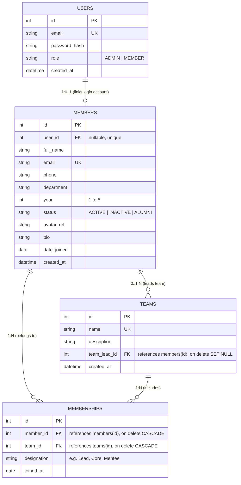

# ACM NITK Membership Management System

🎬 **[Watch Demo Video](https://github.com/Ishitstarlr/membership-management-system)**

A full-stack, responsive web application for managing club memberships, Special Interest Groups (SIGs), team rosters, and real-time club analytics. Built for the **ACM NITK Web Team Recruitment Task**.

---

## 1. Project Overview & Features

### Core Capabilities
* **Authentication & Role-Based Access Control (RBAC):**
  * Secure user registration and login with bcrypt password hashing and 24-hour JWT bearer tokens.
  * Public registration strictly defaults to the `MEMBER` role to prevent unauthorized administrative escalation.
  * Strict backend authorization: Admin-only operations (`POST`, `PUT`, `DELETE` on members/teams/assignments) return `403 Forbidden` if attempted by non-admins.
* **Member Directory & Management:**
  * Displays members with avatars, full contact info, department, year of study (1–5), and status (`ACTIVE`, `INACTIVE`, `ALUMNI`).
  * Full CRUD operations for administrators with confirmation prompts for destructive actions.
  * Real-time search across member names and email addresses.
  * Simultaneous multi-criteria filtering by Department, Year of Study, Status, Team, and Designation.
  * Sorting by Name, Year, and Date Joined (`asc` / `desc`).
  * Server-side pagination with configurable limits.
* **Special Interest Groups (SIGs) & Team Management:**
  * Complete team CRUD: create, edit, and delete teams with descriptions and assigned team leads.
  * View full team rosters with individual designations and member counts.
* **Multi-Team Membership Architecture:**
  * A member can belong to multiple teams simultaneously.
  * Each team assignment has its own independent designation (e.g. *Team Lead* in Web Dev, *Core Member* in AI/ML).
* **Live Analytics Dashboard:**
  * Dynamic statistics calculated directly from the database: Total Members, Active/Inactive/Alumni counts, Total Teams.
  * Visual distribution breakdowns for Department, Year of Study, and Team memberships using responsive plain CSS progress bars.
  * Feed of recently added club members.
* **Responsive, Clean UI:**
  * Built using pure CSS (no Tailwind, Radix, or external UI component libraries).
  * Fully responsive across mobile (375px+), tablet (768px+), and desktop (1200px+) viewports.

---

## 2. Technology Stack & Architecture

```
┌────────────────────────────────────────────────────────┐
│ FRONTEND LAYER                                         │
│ React 18 + Vite (JavaScript)                           │
│ React Router v6                                        │
│ Responsive Plain CSS (Clean modular layout)            │
│ Fetch API with JWT Bearer Interceptors                 │
└───────────────────────────┬────────────────────────────┘
                            │ REST / JSON (HTTP)
┌───────────────────────────▼────────────────────────────┐
│ BACKEND API LAYER                                      │
│ Python 3.12 + FastAPI                                  │
│ Pydantic v2 (Strict Request & Response Validation)     │
│ Auth: PyJWT + bcrypt (passlib)                         │
└───────────────────────────┬────────────────────────────┘
                            │ SQLAlchemy 2.0 ORM
┌───────────────────────────▼────────────────────────────┐
│ DATABASE LAYER                                         │
│ SQLite (with PRAGMA foreign_keys=ON) / PostgreSQL       │
└────────────────────────────────────────────────────────┘
```

---

## 3. Database Schema & ER Diagram



### Entity Separation Decision: `User` vs `Member`
* **`User`** handles authentication secrets (`email`, `password_hash`, system permissions `role`).
* **`Member`** represents public club directory profiles.
* **Justification:** In a college club like ACM NITK, all 100+ members and alumni are displayed in the directory, but only club executives require administrative login credentials. Separating them prevents credential leakage and avoids creating dummy login accounts for members who only need directory representation.

---

## 4. Prerequisites

* **Node.js:** v18+ (tested on Node v26)
* **npm:** v9+
* **Python:** v3.11+ or v3.12 (Python 3.12 recommended)
* **Git**

---

## 5. Setup & Running the Application

### Step 1: Clone the Repository
```bash
git clone https://github.com/Ishitstarlr/membership-management-system.git
cd membership-management-system
```

### Step 2: Backend Setup
```bash
# Navigate to backend and create virtual environment
cd backend
python3.12 -m venv venv
source venv/bin/activate

# Install dependencies
pip install -r requirements.txt

# (Optional) Seed the database with realistic ACM NITK sample data
python app/seed.py

# Start the FastAPI server
uvicorn app.main:app --reload --host 127.0.0.1 --port 8000
```
* Backend runs at: `http://127.0.0.1:8000`
* Interactive API Documentation (Swagger UI): `http://127.0.0.1:8000/docs`

### Step 3: Frontend Setup
Open a second terminal window:
```bash
# Navigate to frontend
cd frontend

# Install node packages
npm install

# Start Vite development server
npm run dev
```
* Frontend runs at: `http://localhost:5173`
* Vite automatically proxies `/api` calls to `http://127.0.0.1:8000`.

---

## 6. Local Demo Credentials (Development Only)

> [!WARNING]
> The credentials below are strictly for local development and grading verification. Never use these credentials in production environments.

| Role | Email | Password | Permissions |
| :--- | :--- | :--- | :--- |
| **Administrator** | `admin@nitk.edu.in` | `admin123` | Full access: Add/Edit/Delete members, teams, and team assignments |
| **Regular Member** | `member@nitk.edu.in` | `member123` | Read-only access: View directory, search, filter, view rosters, view dashboard |

---

## 7. Main REST API Endpoints

| Category | Method | Path | Access | Description |
| :--- | :--- | :--- | :--- | :--- |
| **Auth** | `POST` | `/api/auth/register` | Public | Register user (always assigns `MEMBER` role) |
| | `POST` | `/api/auth/login` | Public | Login and obtain JWT token |
| | `GET` | `/api/auth/me` | Authenticated | Get current authenticated user details |
| | `POST` | `/api/auth/logout` | Authenticated | Clear session confirmation |
| **Members** | `GET` | `/api/members` | Authenticated | List members with search, multi-filters, sort & pagination |
| | `GET` | `/api/members/{id}` | Authenticated | Detailed member profile with all team memberships |
| | `POST` | `/api/members` | **Admin Only** | Create a new member profile |
| | `PUT` | `/api/members/{id}` | **Admin Only** | Update member details |
| | `DELETE` | `/api/members/{id}` | **Admin Only** | Delete member (cascades memberships) |
| | `POST` | `/api/members/{id}/teams` | **Admin Only** | Assign member to a team with designation |
| | `PUT` | `/api/members/{id}/teams/{team_id}` | **Admin Only** | Update designation within a team |
| | `DELETE` | `/api/members/{id}/teams/{team_id}` | **Admin Only** | Remove member from a team |
| **Teams** | `GET` | `/api/teams` | Authenticated | List all teams with member counts and leads |
| | `GET` | `/api/teams/{id}` | Authenticated | Detailed team view with full member roster |
| | `POST` | `/api/teams` | **Admin Only** | Create a new team |
| | `PUT` | `/api/teams/{id}` | **Admin Only** | Update team name, description, or lead |
| | `DELETE` | `/api/teams/{id}` | **Admin Only** | Delete team |
| **Dashboard**| `GET` | `/api/dashboard/stats` | Authenticated | Real-time aggregate statistics and distributions |

---

## 8. Automated Testing & Verification

### Running Backend Tests
Activate the virtual environment and execute pytest:
```bash
backend/venv/bin/pytest backend/test_phase1.py backend/test_phase2.py backend/test_backend.py backend/test_e2e_workflows.py -v
```
**Test Results (16/16 Passed):**
* `test_models_creation_and_relationships`: Verifies database constraints and relationships.
* `test_unique_membership_constraint`: Verifies prevention of duplicate team assignments.
* `test_pydantic_schemas_validation`: Verifies strict input validation and rejection of invalid data.
* `test_registration_success` & `test_registration_duplicate_email`: Verifies auth creation and uniqueness.
* `test_login_success_and_jwt` & `test_login_invalid_credentials`: Verifies JWT issuance and credential checks.
* `test_get_me_protected`: Verifies unauthenticated access rejection.
* `test_rbac_admin_enforcement`: Verifies regular members receive `403 Forbidden` on admin endpoints.
* `test_team_crud_and_rbac`: Verifies complete team lifecycle and permission checks.
* `test_member_crud_and_multi_team_assignments`: Verifies multi-team memberships and independent designations.
* `test_directory_search_filter_sort_pagination`: Verifies search and simultaneous compound filters.
* `test_dashboard_statistics`: Verifies live database aggregations.
* `test_complete_e2e_lifecycle`: Verifies complete end-to-end integration flow.

### Running Frontend Production Build
```bash
cd frontend
npm run build
```
Builds cleanly with zero errors in ~500ms.

---

## 9. Known Limitations & Planned Enhancements

* **Avatar File Uploads:** Current implementation accepts an avatar image URL (e.g. DiceBear / GitHub avatar). Direct multipart image file uploading to local disk or cloud S3 bucket can be added as an enhancement.
* **Password Reset Workflow:** In development, forgotten passwords can be updated directly via the seed script or admin console. An email-based reset token flow can be implemented for production.
